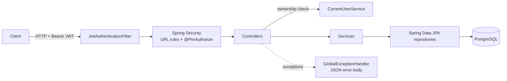

# Parking System

A REST API for running a car park: parking spaces, vehicle entry/exit with tickets, automatic billing,
reservations and feedback. Built with Spring Boot 3, Spring Security (JWT) and PostgreSQL.

This is a personal learning/portfolio project. It is not deployed anywhere and is not production-hardened
(see [Limitations](#limitations)).

## Features

- **Users and authentication** - registration, login with a JWT, BCrypt-hashed passwords, `USER` and `ADMIN` roles.
- **Ownership rules** - a user can only read or change their own profile, vehicles, tickets, bills, reservations
  and feedback. Admins can access everything.
- **Parking spaces** (admin) - create one or many, update, remove. Each space has a type (`NORMAL`, `VIP`,
  `HANDICAPPED`, `EV_CHARGING`, `BIKE`), location, floor, hourly rate and a status: `AVAILABLE`, `RESERVED`, `OCCUPIED` or
  `OUT_OF_SERVICE`. Admins can only take a space out of service (or back) while nobody is using it; a space with
  history is deactivated instead of deleted.
- **Public availability lookup** - anonymous visitors can see free spaces, free spaces per slot type, current
  occupancy, the nearest free slot for a location and type, and a recommendation for their vehicle (an EV gets a
  charging bay first, then a normal one).
- **Vehicles** - register (`CAR`, `BIKE`, `EV`), update, deactivate. A vehicle only parks in slots it fits: bikes in
  `BIKE` bays, only EVs in `EV_CHARGING` bays, cars and EVs in the others. Reserving a space needs a vehicle that
  fits it.
- **Entry / exit** - entry creates an `ACTIVE` ticket and marks the space occupied; exit closes the ticket,
  frees the space and generates the bill in the same transaction. Active tickets can be cancelled. A reserved
  space admits only the driver who reserved it.
- **Safe under concurrent requests** - two cars (or a car and a reservation) can never get the same space: writes
  lock the space row, and unique constraints in the database back that up. Proven by a test that fires
  simultaneous requests at one space.
- **Billing** - one bill per ticket, created on exit, with UUID-based invoice numbers. **Configurable pricing**:
  hourly or slab mode (bands with decreasing rates), tax rate, an optional grace period (short stays are free) and
  an optional daily cap. The defaults are hourly, every started hour, minimum one hour, plus 10% tax. Admins apply
  discounts, record cash payments and see pending bills and total revenue (summed by the database).
- **Online payments** - users pay through a payment provider (a mock one here). Starting a payment needs an
  `Idempotency-Key`, so a retried request never charges twice; the bill becomes PAID only when the provider
  confirms through an HMAC-signed, timestamped webhook. Covers duplicate webhooks, failed and timed-out
  payments, and late confirmations (flagged for refund instead of paying twice). Users can no longer mark
  their own bills as paid.
- **Reservations** - hold a free space for 30 minutes (configurable). The reservation is fulfilled when the driver
  drives in, can be moved or cancelled, and expires on a no-show (a scheduled job frees the space; an overdue hold
  never blocks anyone even before the job runs). One active reservation per user.
- **Feedback** - a 1-5 rating for a reservation that was actually used, once per reservation.
- **Paginated lists** - every list that can grow returns one page shape `{content, page, size, totalElements,
  totalPages, last}` with a stable order; all responses are DTOs, never JPA entities.
- **Consistent errors** - every error is JSON: `{timestamp, status, error, message, path}`. Unexpected errors
  return a generic 500 without internal details.
- **OpenAPI** - interactive docs at `/swagger-ui.html`.

## Tech stack

| Area | Choice |
|------|--------|
| Language / runtime | Java 17 |
| Framework | Spring Boot 3.3 (Web, Data JPA, Security, Validation) |
| Auth | JWT (jjwt 0.11), BCrypt |
| Database | PostgreSQL (H2 in PostgreSQL mode for tests), schema migrations with Flyway |
| API docs | springdoc-openapi 2.6 (Swagger UI) |
| Build / tests | Maven wrapper, JUnit 5, Mockito, MockMvc |
| Packaging / CI | Docker (multi-stage), Docker Compose, GitHub Actions |

## Architecture

A classic layered Spring application: controllers handle HTTP and authorization checks, services hold the
business rules, Spring Data repositories talk to the database.



Package layout (`src/main/java/com/parkingSystem`):

| Package | Contents |
|---------|----------|
| `controller` | REST controllers (`/api/...`) |
| `service`, `service.impl` | Service interfaces and implementations |
| `repository` | Spring Data JPA repositories |
| `model`, `enums` | JPA entities and enums |
| `dto` | Request/response objects with Bean Validation |
| `security` | Current-user/ownership helper, JSON 401/403 handlers |
| `config` | Security, JWT, CORS, OpenAPI, admin seeding |
| `exception` | Custom exceptions and the global exception handler |

More detail: [docs/architecture.md](docs/architecture.md) and [docs/database.md](docs/database.md).

## Running it

### Configuration

All secrets come from environment variables. Copy `.env.example` to `.env` and fill it in (`.env` is git-ignored).

| Variable | Required | Purpose |
|----------|----------|---------|
| `DB_PASSWORD` | yes | PostgreSQL password |
| `JWT_SECRET` | yes | HMAC key for signing tokens, at least 32 characters (the app refuses to start otherwise) |
| `DB_URL` | no | JDBC URL, default `jdbc:postgresql://localhost:5432/parking_system_db` |
| `DB_USERNAME` | no | default `postgres` |
| `JWT_EXPIRATION_MS` | no | token lifetime, default 86400000 (24 h) |
| `RESERVATION_HOLD_MINUTES` | no | how long a reservation holds a space, default 30 |
| `RESERVATION_EXPIRY_CHECK_MS` | no | how often no-show reservations are expired, default 60000 (1 min) |
| `CORS_ALLOWED_ORIGINS` | no | comma-separated frontend origins, default `http://localhost:3000` |
| `PAYMENT_WEBHOOK_SECRET` | yes | HMAC key shared with the payment provider for webhook signatures, at least 32 characters |
| `PAYMENT_TIMEOUT_MINUTES` | no | how long a payment may wait for the provider's confirmation, default 15 |
| `PAYMENT_MOCK_ENABLED` | no | serve the mock provider's checkout endpoints, default `true`; set `false` with a real provider |
| `PRICING_MODE` | no | `HOURLY` (default) or `SLAB`, for the bill created on exit |
| `PRICING_TAX_RATE` | no | tax as a fraction of the base amount, default `0.10` |
| `PRICING_GRACE_PERIOD_MINUTES` | no | stays this short are free, default `0` (off) |
| `PRICING_DAILY_CAP_HOURS` | no | most hours charged per started 24 hours, default `0` (off) |
| `ADMIN_USERNAME`, `ADMIN_EMAIL`, `ADMIN_PASSWORD` | no | if all three are set, an `ADMIN` account is created on startup (skipped if it already exists) |

There is no separate admin sign-up: set the three `ADMIN_*` variables to get the first admin account.

### With Docker Compose

```bash
cp .env.example .env   # set DB_PASSWORD, JWT_SECRET and optionally ADMIN_*
docker compose up --build
```

This starts PostgreSQL 16 (with a health check) and the API on http://localhost:8080.

### Locally

Requires JDK 17+ and a running PostgreSQL with a database named `parking_system_db`.

```bash
export DB_PASSWORD=...
export JWT_SECRET=a-random-string-of-at-least-32-characters
./mvnw spring-boot:run          # Windows: mvnw.cmd spring-boot:run
```

The schema is created by Flyway migrations (`src/main/resources/db/migration`) on startup; Hibernate only
validates it. A database created by an older version of this app is upgraded automatically, see
[docs/database.md](docs/database.md#migrations).

## API overview

Full, interactive documentation: **http://localhost:8080/swagger-ui.html** (click *Authorize* and paste the token
from the login response).

Quick start:

```bash
# register and log in
curl -X POST localhost:8080/api/users/register -H 'Content-Type: application/json' \
  -d '{"userName":"alice","userEmail":"alice@example.com","password":"password123","licencePlate":"AB-123"}'
curl -X POST localhost:8080/api/auth/login -H 'Content-Type: application/json' \
  -d '{"username":"alice","password":"password123"}'
# -> {"token":"...","role":"USER","userId":1}

# public: what is free right now?
curl localhost:8080/api/slots/availability-summary
```

| Area | Base path | Access |
|------|-----------|--------|
| Login | `POST /api/auth/login` | public |
| Users | `/api/users` (`register`, `details`, `update`) | register public; others owner or admin |
| Vehicles | `/api/vehicles` | owner or admin; `GET /all/active` admin |
| Entry / exit | `/api/parking` (`entry`, `exit`, `cancel`, `ticket/{ref}`, `history/{userId}`, `user-active/{userId}`) | owner or admin; `GET /occupancy` public; `GET /active-sessions` admin |
| Parking spaces | `/api/parkingspace` | admin; `GET /available` public |
| Slot lookup | `GET /api/slots/...` | public |
| Billing | `/api/billing` | `invoice`, `user/{id}` owner or admin; generate, discount, `pay` (cash), `pending-all`, `revenue-total` admin |
| Payments | `POST /api/payments` (header `Idempotency-Key`), `GET /api/payments/{id}`, `GET /api/payments/bill/{billId}` | bill owner (start); owner or admin (read) |
| Payment webhook | `POST /api/payments/webhook` | the provider; no JWT, HMAC signature required |
| Mock provider | `POST /api/mock-provider/checkout/{providerReference}?outcome=SUCCEEDED\|FAILED` | the payer or admin |
| Reservations | `/api/reservation` (`register`, `details`, `user`, `update`, `remove` = cancel) | owner or admin; `GET /all/details` admin |
| Feedback | `/api/feedback` | owner or admin; `GET /all/details` admin |

Where a request body has an optional `userId` (vehicle registration, entry, reservation, feedback), it defaults to
the logged-in user.

**Lists** take `?page=0&size=20` (size 1-100) and return

```json
{"content": [ ... ], "page": 0, "size": 20, "totalElements": 57, "totalPages": 3, "last": false}
```

Each list has a fixed, total sort order (for example bills newest first, spaces by floor then number), so pages
never overlap or skip items. Short, bounded lists (a user's currently parked vehicles, payments of one bill,
feedback of one reservation) are plain arrays.

## Security model

- **Authentication**: `POST /api/auth/login` returns an HS256-signed JWT containing the username and role. Send it as
  `Authorization: Bearer <token>`. Sessions are stateless.
- **Invalid tokens**: missing credentials, malformed or expired tokens get a JSON `401`.
- **Roles**: `USER` (default on registration) and `ADMIN`. Admin-only endpoints use `@PreAuthorize("hasRole('ADMIN')")`
  and return `403` for normal users. The role cannot be changed through the API.
- **Ownership**: per-record checks in `CurrentUserService` compare the record's owner with the caller; access to
  another user's data returns `403`. Passwords can only be changed by the account owner.
- **Passwords** are stored as BCrypt hashes and are never included in responses.
- **CORS** is configured centrally in `CorsConfig`.
- **Payment webhooks** are public but trusted only with a valid HMAC-SHA256 signature over the timestamp and the raw
  body; timestamps older than 5 minutes are rejected (no replays) and signatures are compared in constant time.

## Testing

```bash
./mvnw test     # or ./mvnw verify, as CI does
```

Tests run without PostgreSQL: the `test` profile (`src/test/resources/application-test.properties`) uses an
in-memory H2 database in PostgreSQL mode, built by the same Flyway migrations as production, and a dummy JWT
secret. Time-based rules use an injected `Clock`, so tests move time forward instead of sleeping.

- **Unit tests** (JUnit 5 + Mockito): billing (hourly, slab, minimum charge, duplicates, discounts, payment),
  slot allocation, entry/exit rules including reserved, expired and out-of-service spaces, admin seeding.
- **Integration tests** (`@SpringBootTest` + MockMvc): register/login, 401 without/with bad or expired token,
  403 on another user's data and on admin endpoints, role-escalation attempt, public availability endpoints,
  validation errors, and a full entry -> exit -> bill flow.
- **Reservation life cycle** (`ReservationLifecycleIntegrationTest`): the owner drives into their reserved space,
  others are refused, no-shows expire (by the job and at the gate), one hold per user, cancel, move without
  extending the hold, feedback rules, admin status changes and removal of spaces.
- **Concurrency** (`ConcurrencyIntegrationTest`): eight simultaneous entries or reservations for one space give
  exactly one success and seven 409s; a reservation racing a walk-in gives exactly one winner; the database
  rejects a second active ticket for a space or vehicle even when the service is bypassed; eight simultaneous
  payment attempts for one bill start exactly one payment.
- **Payments** (`PaymentIntegrationTest`, `WebhookSignerTest`): idempotent retries, only the webhook settles the bill,
  ownership, one payment at a time and timeouts, failed payments, late confirmations flagged for refund, webhook
  signature / replay / duplicate / conflicting deliveries, and admin actions blocked during an online payment.
- **Pricing** (`PricingCalculatorTest`, `PricingConfigurationIntegrationTest`): the default prices, tax rounding,
  grace period, daily cap (hourly and slab), custom slabs, invalid settings rejected at startup, and settings
  changing the bill created on exit.
- **API shape and slot rules** (`ApiShapeAndSlotRulesIntegrationTest`): pages without overlap or gaps, page
  parameter validation, DTO responses, revenue sum, which vehicle fits which slot, reservations needing a fitting
  vehicle, and vehicle-aware recommendations.

GitHub Actions (`.github/workflows/ci.yml`) runs `./mvnw -B verify` on JDK 17 for every push and pull request,
twice: once on H2 and once against a real PostgreSQL 16 service container, so the migrations, row locks and
constraints are also proven on the production database engine.

## Limitations

Known gaps, kept here deliberately rather than hidden:

- Reservations hold a space from now; booking a space for a later time slot is not supported.
- Payments use a mock provider; refunds flagged `REFUND_REQUIRED` are not processed automatically, and timed-out
  payments are expired lazily (on the next attempt or confirmation), not by a job.
- JWTs are bound to the username and cannot be revoked; changing your user name requires logging in again.
- VIP and HANDICAPPED bays accept any car or EV: there is no membership or permit model to check against.

## Roadmap

See [docs/roadmap.md](docs/roadmap.md).
