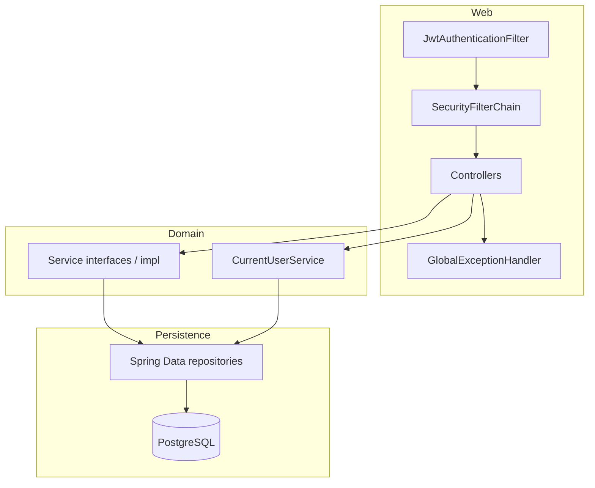
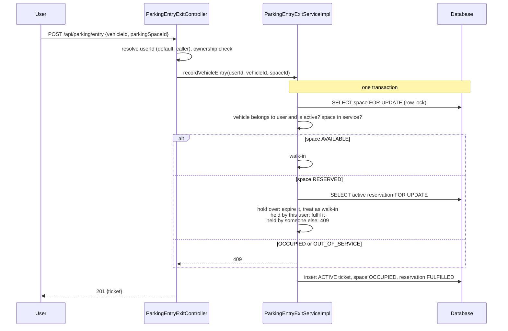
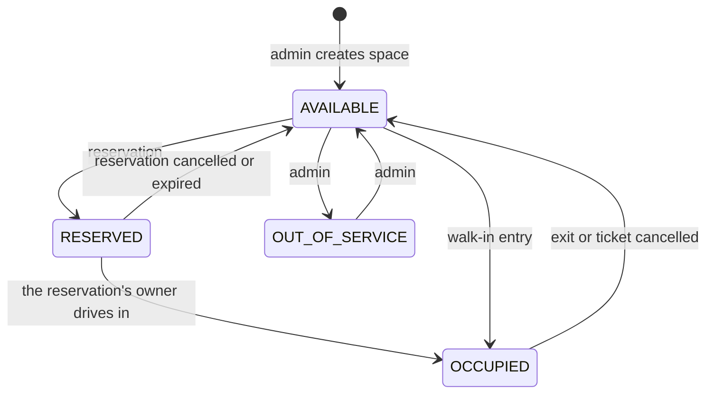
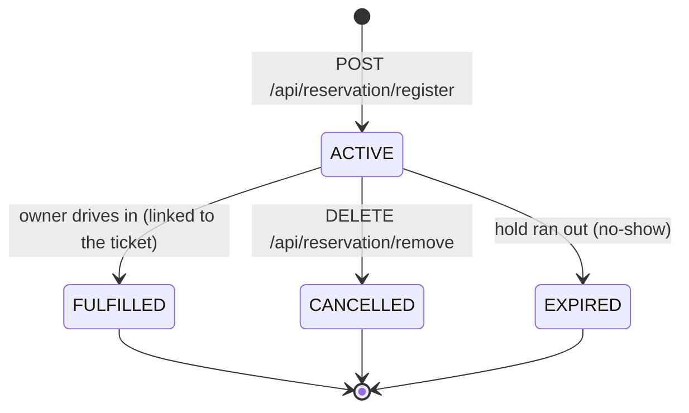

# Architecture

This document describes how the code is actually organised. It intentionally covers only what exists.

## Layers



- **Controllers** (`controller`) map HTTP to service calls, validate request DTOs with `@Valid`, apply
  `@PreAuthorize` for admin-only operations and call `CurrentUserService` for ownership checks. They convert entities
  to response DTOs so internal fields (for example password hashes) never leave the API.
- **Services** (`service`, `service.impl`) contain the business rules and transaction boundaries. They throw
  `ResourceNotFoundException` (404), `ConflictException` (409) or `BadRequestException` (400).
- **Repositories** (`repository`) are Spring Data JPA interfaces with derived and JPQL queries, plus the
  `...ForUpdate` queries that take row locks (see [Concurrency](#concurrency)).
- **Scheduling** (`scheduling`) holds `ReservationExpiryJob`, enabled by `SchedulingConfig` unless
  `app.scheduling.enabled=false`.
- **GlobalExceptionHandler** (`exception`) turns exceptions into a JSON body `{timestamp, status, error, message, path}`.
  Anything unexpected is logged and returned as a generic 500.

## Security

| Concern | Where |
|---------|-------|
| Token issue | `AuthController` -> `JwtUtil.generateToken` (HS256, subject = username, `role` claim) |
| Token check | `JwtAuthenticationFilter` parses the bearer token; expired or malformed tokens get a JSON 401 |
| Public vs. authenticated URLs | `SecurityConfig` |
| Admin-only operations | `@PreAuthorize("hasRole('ADMIN')")` on controller methods (`@EnableMethodSecurity`) |
| Ownership | `CurrentUserService.checkAccess(ownerUserId)` / `resolveUserId(...)` |
| 401 / 403 bodies outside MVC | `RestAuthenticationEntryPoint`, `RestAccessDeniedHandler`, `ErrorResponseWriter` |
| First admin account | `AdminSeeder` (only when `ADMIN_USERNAME`, `ADMIN_EMAIL`, `ADMIN_PASSWORD` are set) |
| CORS | `CorsConfig` (`app.cors.allowed-origins`) |

Public endpoints: `POST /api/users/register`, `POST /api/auth/login`, `GET /api/slots/**`,
`GET /api/parkingspace/available`, `GET /api/parking/occupancy`, Swagger UI and `/v3/api-docs`.

## Main flows

### Vehicle entry



### Vehicle exit and billing

```mermaid
sequenceDiagram
    participant U as User
    participant C as ParkingEntryExitController
    participant S as ParkingEntryExitServiceImpl
    participant B as BillingServiceImpl
    U->>C: POST /api/parking/exit?ticketReference=...
    C->>C: ownership check on the ticket
    C->>S: recordVehicleExit(ref)
    Note over S,B: one transaction
    S->>S: lock space, then ticket; ticket must be ACTIVE<br/>set exit time, duration, CLOSED; space AVAILABLE
    S->>B: generateBill(ticketId)
    B->>B: ticket CLOSED and not yet billed?<br/>hours = max(1, ceil(minutes / 60))<br/>base = hours x rate, tax = 10%
    C-->>U: 200 {ticket, bill}
```

Billing runs inside the exit transaction on purpose: if the bill cannot be created, the exit is rolled back and the
error is returned, so a vehicle can never leave without a bill and the request can simply be retried.

## Space status

A parking space is always in exactly one of four states. `RESERVED` and `OCCUPIED` belong to the system; an admin
can only switch a space between `AVAILABLE` and `OUT_OF_SERVICE`, and not while it is in use.



Before this model existed, a reservation set the space to `occupied`, the same value a parked car used, so the
person who reserved a space was turned away at the gate.

## Reservations

A reservation **holds** an available space for `app.reservation.hold-minutes` (default 30) until the driver
arrives. A user can hold one space at a time.



- **Expiry** happens in two places: `ReservationExpiryJob` runs every `app.reservation.expiry-check-ms`
  (default 60 s) and expires overdue holds; and any request that meets an overdue hold (a driver at the gate, or the
  same user reserving again) expires it on the spot, so a stale hold never blocks anyone between job runs.
- **Moving** a reservation to another space keeps the original `expiresAt`; otherwise a driver could hold a space
  forever by moving back and forth.
- **Cancelling** keeps the row (status `CANCELLED`). Reservations are never deleted, because feedback refers to them.
- **Feedback** is accepted only for a `FULFILLED` reservation, once.
- **Duration** is the driver's expected stay (1-24 hours). It is informational; billing always uses the ticket's
  real entry and exit times.

## Concurrency

The dangerous case is two requests for the same space at the same moment: two cars entering, two drivers
reserving, or a reservation and a walk-in. Each would read "available" and both would succeed.

**Rule: the parking-space row is the lock for everything that happens to that space.** Every write path starts by
loading the space with `SELECT ... FOR UPDATE` (`ParkingSpaceRepository.findByIdForUpdate`) and only then reads
or changes tickets and reservations for it. Competing requests queue on that row; the second one sees the new status
and gets a 409.

- **Lock order** is always *space(s), then reservation or ticket*. When two spaces are involved (moving a reservation,
  or replacing a user's stale hold) they are locked in ascending id order. One global order means no deadlocks.
- **Ids are read before locking** with id-only queries (`findSpaceIdByReservationId`, `findSpaceIdByTicketReference`),
  so no entity is loaded into the persistence context, possibly stale, before its lock is held.
- **Database safety net**: the unique `active_*` guard columns (see [database.md](database.md)) make a second ACTIVE
  ticket or reservation for the same space impossible even if code bypasses the lock. A violation becomes a 409.
- **Multiple app instances** are safe for the same reasons; the expiry job re-checks each reservation under its lock,
  so two instances never expire the same reservation twice.

`ConcurrencyIntegrationTest` fires eight simultaneous entries (and eight reservations) at one space and checks that
exactly one succeeds and seven get a 409. With the lock removed the same test fails: two cars get the space, and a
reservation and a walk-in both succeed.

## Time

Services read the time from an injected `java.time.Clock` (`TimeConfig`), never `LocalDateTime.now()` directly.
Tests swap in a `MutableClock` to jump past a reservation hold or fix a billing time without sleeping. Timestamps are
truncated to microseconds, the database's precision, so a value returned by the API equals the value read back later.

## Pricing

- **Hourly** (used automatically on exit): every started hour is charged, minimum one hour.
- **Slab** (admin, `POST /api/billing/generate-slab/{ticketId}`): first hour 100%, hours 2-3 at 90%, hours 4-8 at 80%,
  beyond 8 at 70% of the hourly rate.
- Tax: 10% of the base amount. Amounts are rounded to 2 decimals.
- One bill per ticket (checked in the service and enforced by a unique constraint on `bills.ticket_id`).
- Invoice numbers are `INV-<UUID>`.
