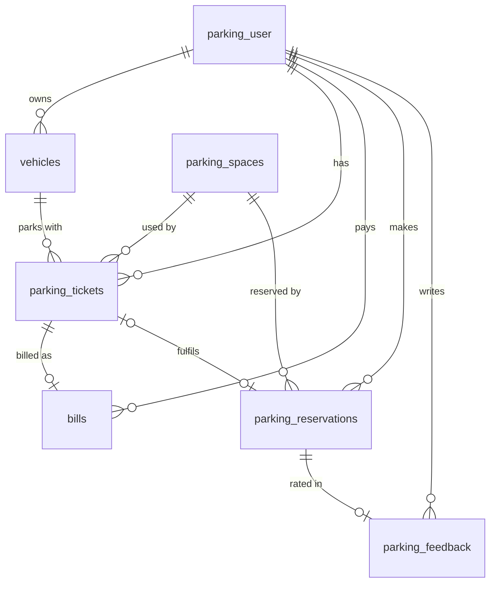

# Database

PostgreSQL in normal use; H2 (PostgreSQL mode) in tests. The schema is owned by **Flyway** migrations in
`src/main/resources/db/migration`; Hibernate only validates that the entities match it
(`spring.jpa.hibernate.ddl-auto=validate`). The tests run the same migrations on H2, so every test run also
checks that the migrations apply cleanly.

## Migrations

| Version | File | What it does |
|---------|------|--------------|
| V1 | `V1__baseline_schema.sql` | The schema exactly as Hibernate created it before Flyway was introduced |
| V2 | `V2__space_status_enum.sql` | `availability_status` becomes a fixed set of values; spaces held only by a legacy reservation are released |
| V3 | `V3__one_active_ticket_per_space_and_vehicle.sql` | Database guarantee: at most one ACTIVE ticket per space and per vehicle |
| V4 | `V4__reservation_lifecycle.sql` | Reservation status, hold expiry, link to the ticket; legacy reservations closed as EXPIRED |

**Existing databases.** A database created by an older version of the app (`ddl-auto=update`) is adopted as
version 1 (`spring.flyway.baseline-on-migrate=true`) and gets V2-V4 on the next start. If V3 fails, that database
already contains two ACTIVE tickets for one space or vehicle (the old double-booking bug); close the duplicates by
hand and start again. For a throwaway local database, dropping and recreating it is simplest.

**Changing the schema.** Add a new `V<n>__description.sql` file; never edit a migration that has already run.

## Entity relationships

## The "active guard" columns

Two business rules must hold even if two requests race each other:

- a space has at most one ACTIVE ticket and at most one ACTIVE reservation;
- a vehicle has at most one ACTIVE ticket, and a user at most one ACTIVE reservation.

PostgreSQL could express these as partial unique indexes (`... WHERE status = 'ACTIVE'`), but H2, used by the
tests, has no partial indexes. The portable pattern used instead: each table has nullable `active_*` columns that
the entity fills while the row is ACTIVE and clears otherwise (`@PrePersist` / `@PreUpdate`). A plain unique
constraint ignores NULLs, so only ACTIVE rows compete. The services' row locks prevent the race in the first place;
these constraints are the safety net, and a violation is returned as a 409.

## Tables

### parking_user (`User`)
| Column | Notes |
|--------|-------|
| user_id | PK, identity |
| user_name | unique |
| user_email | unique |
| user_password | BCrypt hash, never returned by the API |
| license_plate | |
| role | `USER` (default) or `ADMIN`, not null |
| registration_date, created_date | |

### vehicles (`Vehicle`)
| Column | Notes |
|--------|-------|
| vehicle_id | PK |
| user_id | FK -> parking_user, not null |
| license_plate | unique, not null |
| vehicle_type | `CAR`, `BIKE`, `EV` |
| vehicle_model, vehicle_color | |
| registration_number | unique |
| is_active | soft delete flag |
| created_at, updated_at | |

### parking_spaces (`ParkingSpace`)
| Column | Notes |
|--------|-------|
| parking_space_id | PK |
| space_number | unique, not null |
| availability_status | `AVAILABLE`, `RESERVED`, `OCCUPIED`, `OUT_OF_SERVICE` (check constraint) |
| location, floor_number | |
| slot_type | `NORMAL`, `VIP`, `HANDICAPPED` |
| rate_per_hour | decimal, not null |
| is_active | false = removed by an admin but kept because tickets or reservations refer to it |
| notes, created_at, updated_at | |

### parking_tickets (`ParkingTicket`)
| Column | Notes |
|--------|-------|
| ticket_id | PK |
| ticket_reference | unique, `TKT-` + random suffix |
| user_id, vehicle_id, parking_space_id | FKs, not null |
| entry_time, exit_time, duration_minutes | exit fields set on exit or cancel |
| status | `ACTIVE`, `CLOSED`, `CANCELLED` |
| active_space_id, active_vehicle_id | guard columns, **unique**; set only while ACTIVE |
| entry_photo_url, exit_photo_url | present in the entity, not used by the API |
| notes, created_at | cancel reason is stored in notes |

### bills (`Bill`)
| Column | Notes |
|--------|-------|
| bill_id | PK |
| invoice_number | unique, `INV-<UUID>` |
| user_id | FK -> parking_user |
| ticket_id | FK -> parking_tickets, **unique** (one bill per ticket) |
| rate_per_hour, duration_hours | |
| base_amount, tax_amount, discount_amount, total_amount | decimals |
| status | `PENDING`, `PAID`, `CANCELLED` |
| payment_method, payment_date, billing_date, notes, created_at | |

### parking_reservations (`Reservation`)
| Column | Notes |
|--------|-------|
| reservation_id | PK |
| user_id, parking_space_id | FKs, not null |
| reservation_time | when it was made |
| duration | expected stay in hours, 1-24; informational, billing uses the ticket |
| status | `ACTIVE`, `FULFILLED`, `CANCELLED`, `EXPIRED` (check constraint) |
| expires_at | end of the hold (`reservation_time` + `app.reservation.hold-minutes`) |
| fulfilled_at, cancelled_at, updated_at | |
| ticket_id | FK -> parking_tickets, set when the owner drives in |
| active_space_id, active_user_id | guard columns, **unique**; set only while ACTIVE |

Index `ix_reservations_status_expires (status, expires_at)` serves the expiry job.

### parking_feedback (`Feedback`)
| Column | Notes |
|--------|-------|
| feedback_id | PK |
| user_id, reservation_id | FKs, not null; the reservation must belong to the user and be FULFILLED; one feedback per reservation (checked by the service) |
| rating | 1-5 (validated by the API) |
| comments | up to 255 characters |

## Notes

- Reservations are never deleted, only cancelled, so feedback and history keep a valid reference.
- A parking space with history is deactivated instead of deleted; a space with no tickets or reservations is
  deleted.
